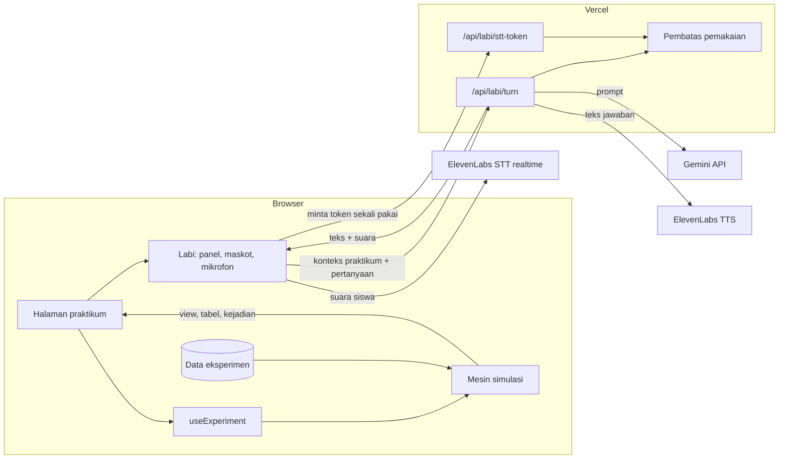

# Virtual Lab

Lab virtual kimia dan fisika untuk siswa SMA, ditemani Labi, asisten lab berbasis AI.

 

Dibuat untuk **Logicodix 2026 Hackathon**, subtema **Smart & Fun Education**.

## Tim

**Nama tim:** _(PLUGIN)_

| Nama                     | Peran              | Bagian yang dikerjakan                                                                                                     |
| ------------------------ | ------------------ | -------------------------------------------------------------------------------------------------------------------------- |
| Muhammad Raditya Alfajri | Ketua tim, Backend | Setup proyek dan CI, mesin simulasi, data dan rumus eksperimen kimia, halaman praktikum dan adegan kimia, integrasi Gemini |
| Muhammad Zidna Fadla     | Backend            | Data dan adegan eksperimen fisika, tata letak lab layar penuh, Labi (AI dan suara), tampilan HP                            |
| Raihan Putra Khairullah  | Frontend           | Halaman Katalog dan Detail eksperimen                                                                                      |
| Raja Aunur Rahman        | Frontend           | Halaman Beranda dan Pilih Laboratorium                                                                                     |

## Tentang Virtual Lab

### Masalahnya

Praktikum di banyak SMA masih sulit dilakukan. Alat dan bahan terbatas, waktunya sempit, dan beberapa bahan berbahaya kalau tidak diawasi. Akhirnya praktikum sering diganti dengan membaca langkah di buku atau menonton video, sehingga siswa tidak pernah benar-benar mencoba.

Saat praktikum berjalan pun, satu guru biasanya mendampingi satu kelas penuh. Siswa yang bingung jarang sempat bertanya, dan banyak yang hanya mengikuti prosedur tanpa tahu kenapa hasilnya seperti itu.

### Solusi kami

Virtual Lab adalah meja praktikum di browser. Siswa bebas menyeret alat dan bahan seperti di lab sungguhan, melihat prosesnya terjadi pelan-pelan, mengukur hasilnya dengan alat ukur, lalu datanya tercatat sendiri di tabel. Tidak ada urutan langkah yang dipaksakan, jadi siswa bisa mencoba, salah, dan mengulang sebanyak yang mereka mau.

Selama praktikum, siswa ditemani **Labi**, robot asisten lab. Labi membantu di awal, menjawab pertanyaan lewat teks atau suara, dan menjelaskan apa yang baru saja terjadi di meja lab. Angka hasil eksperimen selalu dihitung oleh simulasi, bukan oleh AI, jadi hasilnya bisa dipercaya.

### Target pengguna

- **Siswa SMA** (pengguna utama), terutama yang jarang mendapat kesempatan praktikum di sekolah
- **Guru** yang butuh media praktikum untuk kelas atau tugas rumah

## Fitur Utama

**Enam eksperimen yang bisa dimainkan**

| Lab    | Eksperimen          | Yang dipelajari                                                                 |
| ------ | ------------------- | ------------------------------------------------------------------------------- |
| Kimia  | Uji Asam dan Basa   | Menentukan sifat lima larutan dengan indikator universal dan kartu pH           |
| Kimia  | Konsentrasi Larutan | Menimbang CuSO₄, mencampur, mengaduk, menghitung molaritas, dan pengenceran     |
| Kimia  | Laju Reaksi         | Pengaruh suhu dan konsentrasi pada reaksi Na₂S₂O₃ dan HCl (metode tanda silang) |
| Fisika | Hukum Newton        | Hubungan gaya, massa, dan percepatan troli                                      |
| Fisika | Ayunan Sederhana    | Pengaruh panjang tali dan massa bandul pada periode                             |
| Fisika | Hukum Hooke         | Menentukan konstanta pegas dari beban dan pertambahan panjang                   |

**Meja lab yang bebas dan hidup**

- Seret benda ke tujuan, atau di HP cukup ketuk benda lalu ketuk tujuannya
- Proses berjalan bertahap: warna berubah, zat larut sambil diaduk, suhu naik, tanda silang memudar
- Data hanya tercatat lewat alat ukur dan masuk otomatis ke tabel pengamatan
- Aksi yang tidak mungkin ditolak dengan alasan singkat, misalnya "Satu tabung hanya untuk satu larutan"
- Setiap hasil disertai penjelasan: hasil, alasan, dan rumusnya
- Kecepatan waktu 1× dan 5× untuk proses yang lama, serta tombol Reset

**Labi, asisten lab berbasis AI**

- Memandu di awal sampai data pertama tercatat, setelah itu siswa bebas bereksperimen
- Menjawab pertanyaan sesuai isi meja dan tabel yang sedang dikerjakan siswa
- Bisa diajak bicara: tahan tombol untuk bicara, dan Labi menjawab dengan suara
- Bereaksi di momen penting dengan ekspresi dan penjelasan singkat
- Tetap sopan dan beralih ke mode sederhana kalau layanan AI sedang tidak tersedia

**Bisa dipakai di mana saja**

- Tampilan laptop berupa ruang lab layar penuh dengan panel melayang
- Tampilan HP dengan area kerja per bagian meja, rak alat di bawah, dan panel yang bisa ditarik
- Katalog dengan pencarian dan filter topik, serta halaman detail tiap eksperimen

## Teknologi

| Bagian                | Yang dipakai                                                                                          |
| --------------------- | ----------------------------------------------------------------------------------------------------- |
| Tampilan              | React 19, TypeScript, Vite, Tailwind CSS 4, React Router                                              |
| Interaksi dan animasi | dnd-kit, Motion                                                                                       |
| Ikon                  | Lucide                                                                                                |
| Pengujian             | Vitest                                                                                                |
| Server                | Serverless function di Vercel (folder `api/`)                                                         |
| AI percakapan         | Gemini API (Google AI Studio), model `gemini-3.5-flash-lite`                                          |
| Suara                 | ElevenLabs Speech to Text (realtime) dan Text to Speech                                               |
| Pembatas pemakaian    | Upstash Redis (opsional)                                                                              |
| Hosting               | Vercel                                                                                                |
| Database              | Tidak ada. Aplikasi tidak menyimpan data pengguna; tabel pengamatan hanya ada selama praktikum dibuka |

## Arsitektur dan Alur Data



Cara kerjanya dalam satu putaran:

1. Siswa menyeret benda. Mesin simulasi memeriksa aturan eksperimen, lalu memperbarui keadaan meja, tabel, dan daftar kejadian (misalnya `color-changed` atau `record-added`).
2. Tampilan menggambar ulang meja dari data `view`, dan Labi bereaksi sesuai kejadian.
3. Saat siswa bertanya, aplikasi mengirim konteks praktikum (eksperimen, isi tabel, kejadian terakhir) dan pertanyaannya ke `/api/labi/turn`.
4. Server memeriksa batas pemakaian, meminta jawaban ke Gemini, lalu mengubah jawabannya menjadi suara lewat ElevenLabs.
5. Kalau siswa berbicara, browser meminta token sekali pakai ke `/api/labi/stt-token`, lalu suaranya diubah menjadi teks oleh ElevenLabs. API key tidak pernah sampai ke browser.

Logika eksperimen dipisah dari tampilan:

```
src/
  data/          data tiap eksperimen: benda, tempat, aturan, rumus, kalimat Labi
  lib/           mesin simulasi dan logika Labi di sisi browser
  hooks/         penghubung mesin dan Labi ke React
  simulations/   posisi benda di meja tiap eksperimen (dari desain Figma)
  components/    meja lab, aset alat, panel, katalog, detail, Labi
  pages/         halaman aplikasi
api/             serverless function untuk Labi (percakapan, suara, pembatas)
dev/             plugin Vite agar api/ juga berjalan di localhost
public/img/lab/  latar meja lab tiap eksperimen
```

## Menjalankan Aplikasi

**Yang dibutuhkan:** Node.js versi LTS dan npm.

```bash
git clone https://github.com/raditya-alfajri/Virtual-Lab.git
cd Virtual-Lab
npm install
cp .env.example .env    # di Windows: copy .env.example .env
```

Isi `.env` (lihat tabel di bawah), lalu jalankan:

```bash
npm run dev
```

Buka `http://localhost:5173`. Endpoint Labi di folder `api/` ikut berjalan di server yang sama lewat plugin di `dev/api-routes.ts`, jadi tidak perlu menjalankan server terpisah.

Perintah lain:

| Perintah                | Fungsi                                                |
| ----------------------- | ----------------------------------------------------- |
| `npm run test -- --run` | Menjalankan semua unit test (mesin, eksperimen, Labi) |
| `npm run lint`          | Memeriksa kode dengan ESLint                          |
| `npm run format`        | Merapikan kode dengan Prettier                        |
| `npm run build`         | Membuat versi produksi di folder `dist/`              |

### Variabel lingkungan

Semua kunci hanya dibaca oleh fungsi di folder `api/`, tidak pernah dikirim ke browser. Untuk versi online, isi variabel yang sama di **Vercel → Settings → Environment Variables**.

| Nama                                                 | Wajib | Keterangan                                                          |
| ---------------------------------------------------- | ----- | ------------------------------------------------------------------- |
| `GEMINI_API_KEY`                                     | Ya    | API key dari Google AI Studio                                       |
| `GEMINI_MODEL`                                       | Ya    | Model Gemini yang dipakai, misalnya `gemini-3.5-flash-lite`         |
| `ELEVENLABS_API_KEY`                                 | Ya    | API key ElevenLabs dengan akses Text to Speech dan Speech to Text   |
| `GEMINI_REASONING_EFFORT`                            | Tidak | Seberapa lama model berpikir sebelum menjawab, misalnya `minimal`   |
| `GEMINI_BASE_URL`                                    | Tidak | Endpoint Gemini yang kompatibel dengan OpenAI                       |
| `ELEVENLABS_VOICE_ID`                                | Tidak | Suara Labi                                                          |
| `ELEVENLABS_TTS_MODEL`, `ELEVENLABS_STT_MODEL`       | Tidak | Model suara keluar dan masuk                                        |
| `LABI_DAILY_TURNS`                                   | Tidak | Batas jawaban Labi per hari untuk semua pengunjung (bawaan 400)     |
| `LABI_GLOBAL_RPM`                                    | Tidak | Batas jawaban Labi per menit untuk semua pengunjung (bawaan 15)     |
| `UPSTASH_REDIS_REST_URL`, `UPSTASH_REDIS_REST_TOKEN` | Tidak | Penyimpanan bersama untuk pembatas pemakaian di Vercel (disarankan) |

Tanpa kunci AI, praktikum tetap bisa dimainkan penuh. Labi saja yang beralih ke mode sederhana.

### Akun demonstrasi

Tidak diperlukan. Aplikasi tidak memakai login, jadi semua fitur bisa langsung dicoba tanpa akun.

### Catatan mikrofon

Fitur bicara dengan Labi membutuhkan izin mikrofon dari browser, dan hanya bisa berjalan di `localhost` atau alamat `https` (seperti alamat Vercel).

## Penggunaan AI

### Di dalam aplikasi

| Layanan                                       | Model                   | Dipakai untuk                                                |
| --------------------------------------------- | ----------------------- | ------------------------------------------------------------ |
| Gemini API (Google AI Studio, tingkat gratis) | `gemini-3.5-flash-lite` | Jawaban dan panduan Labi di halaman praktikum                |
| ElevenLabs Speech to Text                     | `scribe_v2_realtime`    | Mengubah suara siswa menjadi teks saat tombol bicara ditahan |
| ElevenLabs Text to Speech                     | `eleven_flash_v2_5`     | Mengubah jawaban Labi menjadi suara                          |

**Data yang dikirim ke Gemini** setiap kali Labi menjawab berisi konteks praktikum yang sedang dibuka:

- nama, topik, tujuan, dan konsep eksperimen
- posisi setiap alat di meja dan angka yang ditunjukkan alat ukur
- pertanyaan tebakan dan jawaban tebakan siswa
- isi tabel pengamatan
- kejadian terakhir di meja lab dan penjelasan hasil terakhir yang tampil di layar
- langkah berikutnya menurut panduan praktikum, serta apakah masa panduan sudah selesai
- riwayat percakapan dengan Labi, paling banyak 12 giliran terakhir
- pertanyaan siswa, baik diketik maupun diucapkan

**Data yang dikirim ke ElevenLabs:** suara siswa ke ElevenLabs Speech to Text selama tombol bicara ditahan, dan teks jawaban Labi ke ElevenLabs Text to Speech untuk dijadikan suara.

Aplikasi tidak memakai akun atau login, jadi **tidak ada nama, akun, atau data pribadi siswa yang dikirim** ke layanan mana pun.

**Suara siswa** hanya diproses saat tombol bicara ditahan, diubah menjadi teks oleh ElevenLabs, dan tidak disimpan oleh aplikasi. Browser selalu meminta izin mikrofon terlebih dahulu, dan siswa tetap bisa mengetik kalau tidak ingin memakai suara.

**Batasan yang kami terapkan:**

- Angka di tabel pengamatan dan panel Penjelasan (pH, konsentrasi, waktu, percepatan, periode, konstanta pegas) selalu dihitung oleh mesin simulasi. Labi diinstruksikan untuk merujuk angka dari simulasi dan tidak menghitung sendiri, tetapi karena jawabannya dibuat oleh model AI, angka yang disebut Labi saat bicara sebaiknya dicek ke tabel.
- Labi menjawab singkat dalam bahasa Indonesia dan hanya membahas praktikum yang sedang dibuka.
- Ada batas pemakaian per pengunjung, per menit, dan per hari supaya kuota tidak habis dan sumber daya tidak terbuang.
- Kalau layanan AI menolak atau gagal, praktikum tetap berjalan dan Labi menampilkan pesan yang sopan.
- Setiap jawaban Labi yang dibuat AI diberi label "AI", di panel chat maupun di balon maskot, dan panel Labi selalu menampilkan catatan bahwa AI bisa keliru. Kalimat yang sudah kami siapkan sendiri (sapaan, pertanyaan tebakan, alasan aksi ditolak, saran langkah, dan kalimat mode sederhana) tidak diberi label karena bukan buatan AI.
- Gemini tingkat gratis dapat memakai konten permintaan untuk meningkatkan layanan Google. Karena itu kami tidak pernah mengirim data pribadi.

### Selama pengembangan

Kami memakai Claude (Anthropic) dan Claude Code sebagai asisten untuk merancang, menulis, dan meninjau kode, serta membantu membuat ilustrasi aset awal. Semua hasilnya kami tinjau, uji, dan sesuaikan sendiri, dan setiap anggota memahami bagian kode yang ia kerjakan.

## Atribusi

| Sumber                                              | Dipakai untuk                   | Lisensi                      |
| --------------------------------------------------- | ------------------------------- | ---------------------------- |
| Template resmi Vite `react-ts`                      | Kerangka awal proyek            | MIT                          |
| React, React Router, Vite, TypeScript, Tailwind CSS | Kerangka aplikasi               | MIT / Apache-2.0             |
| dnd-kit                                             | Seret dan lepas benda           | MIT                          |
| Motion                                              | Animasi                         | MIT                          |
| Lucide                                              | Ikon                            | ISC                          |
| Vitest, ESLint, Prettier                            | Pengujian dan kerapian kode     | MIT                          |
| Inter dan Plus Jakarta Sans (Google Fonts)          | Huruf                           | SIL Open Font License        |
| Gemini API                                          | Jawaban Labi                    | Ketentuan layanan Google     |
| ElevenLabs                                          | Suara Labi dan pengenalan suara | Ketentuan layanan ElevenLabs |
| Upstash Redis                                       | Pembatas pemakaian              | Ketentuan layanan Upstash    |
| Vercel                                              | Hosting dan serverless function | Ketentuan layanan Vercel     |

Kami tidak memakai dataset pihak ketiga. Ilustrasi alat lab, latar meja lab, dan karakter Labi dibuat oleh tim di Figma, sebagian dengan bantuan AI untuk ilustrasi awal, lalu disesuaikan oleh tim. Nilai materi (pH larutan, rumus molaritas, laju reaksi, hukum Newton, periode ayunan, dan hukum Hooke) mengikuti materi kimia dan fisika SMA.

## Tautan

- **Aplikasi:** _(isi alamat Vercel)_
- **Video demo:** _(isi tautan YouTube)_
- **Dokumen produk:** [docs/PRD.md](docs/PRD.md)
